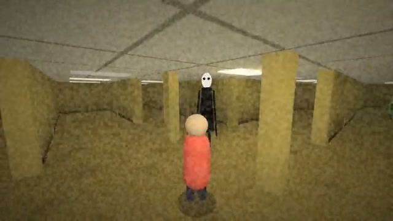

# Endless Halls

Find the keys. Stay together. Don't listen too long. A multiplayer starter game from [Multiplayer Agent](https://multiplayeragent.com): 3D, co-op, 1–4 players, with bot explorers that fill empty seats.

## How it plays

Wander endless yellow halls with your friends to find three keys, then the EXIT to the next level. Something walks the halls with you: you hear it before you see it, and it comes for whoever is alone.

Each key rings a soft chime, panned to where it is; the strip at the top of the screen shows the keys you can hear and where your friends are. Alone, your dread climbs and the screen fills with static. When the entity takes someone, one of the team's three lights goes out and they wake up back at the start. Lose all three and the run is over.

**Controls:** WASD to walk, drag the mouse to look, Shift to run, or the touch stick, drag to look and RUN.

## Make it yours in the Game Builder

Open the [Game Builder](https://multiplayeragent.com), choose **Start from a starter game** and pick Endless Halls. It opens as version 1 in your studio, ready to play and publish. Then ask for changes, for example:

- Add a flashlight with a battery that runs out
- Make every fifth level a flooded pool room
- Add a second entity that only moves when nobody looks at it

## Run it yourself

1. Get a free publishable key (`pk_…`) at [multiplayeragent.com](https://multiplayeragent.com).
2. In `index.html`, put it in place of `pk_REPLACE_ME` in the `MP_CONNECT` block.
3. Serve the folder (for example `npx serve`) and open it. The 3D engine loads as a module, which browsers block from a file on disk.

Without a key it still runs, offline with bot explorers.

## How it is built

- One `index.html` plus three.js in `libs/`. The comment at the top of the script maps the code and explains the multiplayer.
- **Host-run rules:** The host's browser builds each level from a seed, moves the entity and decides who gets taken; if it leaves, the next player takes over.
- **Bots:** Bot explorers search the halls, find keys and run with you until friends join.
- **Live sync:** Everyone walks the same halls and sees each other move.
- **Leaderboard:** The deepest level each player reached.
- The halls are never stored: every wall comes from a hash of the level's seed and its position, and only the part around you is built.
- `?attract` runs it offline with bots only. The preview video is recorded from it.

## License

MIT.
